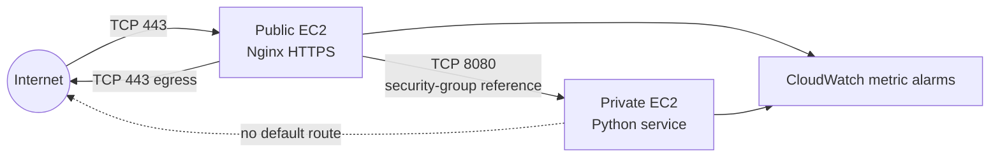

# AWS Cloud Security Lab

Terraform project for a small two-tier AWS lab in `eu-north-1`. It demonstrates VPC segmentation, a public Nginx reverse proxy, a private Python service, EC2 instance profiles, and basic CloudWatch alarms. It is a learning environment, not a production-ready service.

## Architecture

The root Terraform configuration is the active stack. The folders under `modules/networking`, `modules/security-groups`, and `modules/security-services` and the `environments/dev` and `environments/prod` entry points are currently empty placeholders; they do not create separate stacks.

| Component | Confirmed configuration |
|---|---|
| Region | `eu-north-1` |
| VPC | `10.50.0.0/16`, DNS support and hostnames enabled |
| Public subnet | `10.50.1.0/24`, AZ `eu-north-1b`, public IPv4 auto-assignment disabled |
| Private subnet | `10.50.2.0/24`, AZ `eu-north-1b`, no public IPv4 assignment |
| Public routing | Default route through an Internet Gateway |
| Private routing | VPC local route only; no NAT Gateway or VPC endpoints |
| Web instance | Amazon Linux 2023, `t3.micro`, public IPv4, Nginx on TCP 443 |
| App instance | Amazon Linux 2023, `t3.micro`, private IP only, Python HTTP service on TCP 8080 |
| Instance hardening | IMDSv2 required; 8 GiB gp3 root disks encrypted and deleted at termination |
| Monitoring | Four CloudWatch metric alarms for CPU and EC2 status checks; no log shipping or alarm notification targets |
| State | Local Terraform state; no backend is configured |



The web instance explicitly requests a public IPv4 address; the public subnet does not assign public addresses automatically to future instances. The app private address is passed from Terraform to the Nginx user data template. The app security group accepts TCP 8080 only from the web security group. Security groups are stateful, so response packets for an allowed connection do not need a separate reverse rule. The web security group allows public HTTPS ingress and explicit HTTPS plus app-port egress. There is no SSH or RDP ingress rule.

The repository does not define a custom Network ACL. AWS's default network ACL is therefore used; segmentation is enforced by route tables and security groups. Terraform empties the VPC default security group, and neither instance uses it. Both subnets are in one availability zone, so the design has no AZ-level resilience.

See [docs/architecture.md](docs/architecture.md) for traffic flows and trust boundaries.

## Security controls and limitations

- EC2 requires IMDSv2, uses encrypted EBS root volumes, and receives an IAM instance profile.
- The app process runs as a dedicated non-login user with systemd hardening.
- Nginx permits TLS 1.2/1.3 and adds basic response security headers.
- The web certificate is self-signed. Browsers and clients will not trust it without explicit trust configuration; use a DNS name and managed certificate before public production use.
- The app subnet has no internet egress. This avoids NAT cost and direct internet reachability, but prevents app access to package repositories and Systems Manager endpoints. The IAM role alone does not make the private app manageable by SSM.
- The web instance has a route to the internet and the SSM managed policy, but live SSM registration has not been verified.
- Terraform state is local. Keep it outside version control and protect the machine and backups that store it. State encryption, versioning, locking and centralized access control are not configured.
- CloudWatch alarms observe EC2 CPU and status metrics only. There is no CloudTrail trail, CloudWatch Logs ingestion, alarm action or notification channel in this repository.
- The Terraform provisioning policy still has broad EC2 permissions with `Resource = "*"`; this is constrained to `eu-north-1`, but it is not least privilege. Narrowing the full EC2 lifecycle policy needs a plan-backed action/resource review before changing it.

The full assessment and proposed roadmap are in [docs/security-assessment.md](docs/security-assessment.md). Service and cost trade-offs are in [docs/cost-analysis.md](docs/cost-analysis.md). Security reporting guidance is in [SECURITY.md](SECURITY.md).

## Prerequisites

- Terraform CLI (the CI workflow currently validates with 1.10.5).
- For the full local scan suite: TFLint 0.66.0, Checkov 3.4.11, Trivy 0.76.2, and Gitleaks 8.30.1. The workflow pins these versions; use their official installation instructions.
- AWS CLI v2 and an AWS account only for a manual deployment.
- Local AWS CLI profiles `terraform-lab` and `terraform-admin` configured with the required permissions. Terraform uses these profiles; do not put access keys in `.tfvars` or commit credential files.

The security workflow does not authenticate to AWS, run a plan, or deploy infrastructure. Terraform OIDC for future deployment is intentionally not configured.

## Safe local checks

Run from the repository root. These commands initialize providers locally and validate configuration; they do not create AWS resources.

```sh
terraform init -backend=false
terraform fmt -check -recursive
terraform validate
tflint --recursive
checkov -d . --framework terraform --skip-path .terraform --soft-fail --hard-fail-on CKV_AWS_356
trivy config --severity HIGH,CRITICAL --exit-code 1 --skip-dirs .terraform .
gitleaks git --redact --no-banner .
```

The CI workflow runs these checks on pull requests targeting `main` and pushes to `main`, `fix/**`, and `security/**`. It has read-only repository permission and no AWS credentials. Checkov reports all findings and fails on the broad IAM resource-scope check `CKV_AWS_356`; other Checkov findings are reported for review. Trivy fails on High/Critical findings; TFLint and Gitleaks fail on their errors/findings.

## Manual deployment

Review `terraform plan` and the IAM permissions in a controlled AWS account before deployment. The following commands can create billable AWS resources and are not run by CI:

```sh
terraform init
terraform plan
terraform apply
```

Destroying a stack is also a live infrastructure change. Review Terraform state and AWS billing before any manual cleanup. No backend migration is configured; do not switch backend or move state without a separate migration plan and backup.

## Cost profile

The active stack can incur charges for two EC2 instances, two EBS volumes, the web instance's public IPv4 address, CloudWatch alarms, and data transfer. Prices depend on region, runtime, storage and usage; use the AWS Pricing Calculator before a long-running deployment. The current design deliberately has no NAT Gateway or paid interface endpoints.

CloudTrail, centralized log storage, GuardDuty, AWS Config, WAF, ALB and VPC endpoints remain optional follow-up work. Their purpose and cost/complexity trade-offs are documented in [docs/cost-analysis.md](docs/cost-analysis.md); none are enabled by this repository.
