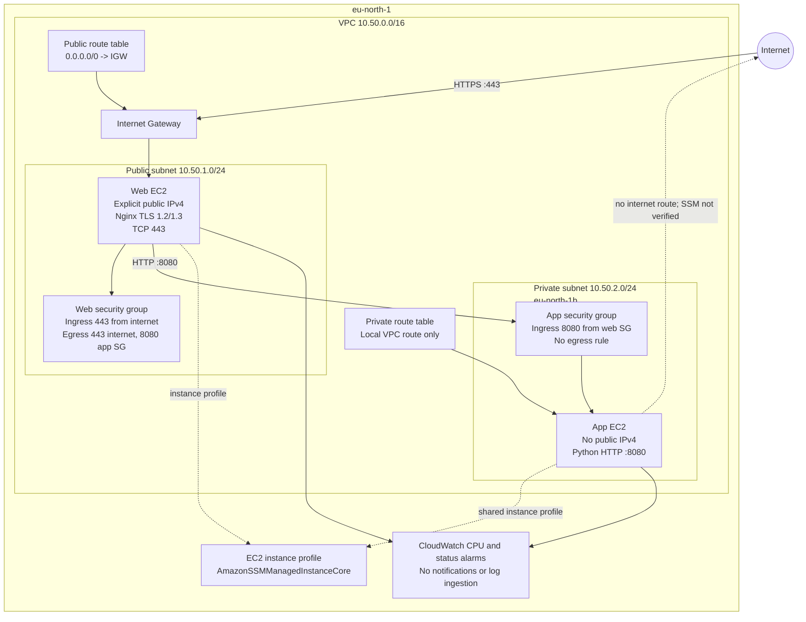

# Architecture and traffic flows

## Confirmed inventory

The repository's active Terraform stack is at the root. It directly declares VPC, subnet, route table and security group resources, then calls the compute, IAM and logging child modules. The other module folders and environment entry points are empty. There is no Terraform backend configuration.

| Area | Confirmed source configuration |
|---|---|
| Region | `eu-north-1`, configured on default and `admin` AWS provider aliases |
| VPC | `10.50.0.0/16`, DNS support and hostnames enabled |
| Subnets | Public `10.50.1.0/24` (public IPv4 auto-assignment disabled) and private `10.50.2.0/24`, both in `eu-north-1b` |
| Public route | `0.0.0.0/0` through an Internet Gateway |
| Private route | Route table association only; implicit local VPC route, no default internet route |
| Web tier | Amazon Linux 2023 `t3.micro`, public subnet, public IPv4, TCP 443 Nginx reverse proxy |
| App tier | Amazon Linux 2023 `t3.micro`, private subnet, no public IPv4, Python HTTP service on TCP 8080 |
| IAM | Terraform policy attached to pre-existing `terraform-lab` IAM user; EC2 role/profile has `AmazonSSMManagedInstanceCore` |
| Security groups | Web: public TCP 443 ingress; TCP 443 internet and TCP 8080 to app egress. App: TCP 8080 ingress from web group; no egress rule configured. VPC default group is empty and unused. |
| Storage | Each root volume 8 GiB gp3, encrypted, deleted on instance termination |
| Monitoring | Four CloudWatch metric alarms: CPU and status checks for each instance; no actions or log groups |
| State | Local state; no remote backend or locking configuration |
| Network ACL | No custom ACL resource; AWS default network ACL is used |

The VPC default security group is emptied by Terraform; neither EC2 instance uses it. No inference is made about actual AWS account resources, deployed state, CloudTrail, DNS, certificate trust, alarm status or SSM registration. Those were not inspected live.

## Architecture diagram

The security-group arrows above represent allowed connection initiation. Security groups are stateful, so response traffic for established connections is allowed automatically.

## Request flows

### Internet to web tier

1. A client connects to the public IPv4 address on TCP 443.
2. The public route table sends internet-bound traffic through the Internet Gateway.
3. The web security group permits TCP 443 ingress from `0.0.0.0/0`.
4. Nginx terminates TLS using a self-signed certificate and proxies the request. Client certificate trust is not provided by this lab certificate.

There is no TCP 80 ingress or HTTP redirect. Public web egress on TCP 443 is allowed to any IPv4 address; that supports package installation and outbound HTTPS but is broader than a destination allowlist.

### Web tier to app tier

1. Nginx proxies to the app's Terraform-assigned private IP on TCP 8080.
2. The web security group egress rule targets the app security group, not a fixed address.
3. The app security group accepts TCP 8080 only from the web security group.
4. VPC local routing carries traffic between subnets. The app sends response traffic through the stateful connection.

The app has no public IPv4 and no route to the internet. Its route table does not include NAT or VPC endpoints, so the instance cannot reach SSM or external package repositories through the declared network.

## Trust boundaries and responsibilities

- **Internet/public boundary:** The web EC2 instance is intentionally internet-reachable on 443. Nginx and its operating system are the externally exposed attack surface.
- **Application boundary:** The private EC2 instance is isolated from direct internet ingress. The security-group reference allows only the web tier to initiate connections on 8080.
- **Control-plane boundary:** Terraform uses separate local profiles for IAM administration and infrastructure provisioning. CI has no AWS role, credentials or deployment permission.
- **Observability boundary:** CloudWatch receives basic AWS/EC2 metrics. Host logs, IAM API events and traffic telemetry are not centralized by this repository.
- **State boundary:** State is local to the operator's working directory. Protection depends on host access controls and backup handling.

## Management and availability limitations

Both EC2 instances use a role with `AmazonSSMManagedInstanceCore`, but the private subnet has no network path to Systems Manager. The web subnet has outbound HTTPS and may reach public SSM endpoints, but successful SSM registration was not verified. Do not rely on SSM for app access until connectivity is explicitly designed and tested.

Both subnets share one AZ (`eu-north-1b`). An AZ disruption affects both tiers. Multi-AZ redundancy would require new subnets, routing, and likely a load balancer or another explicit failover design; it is outside the low-cost baseline.
